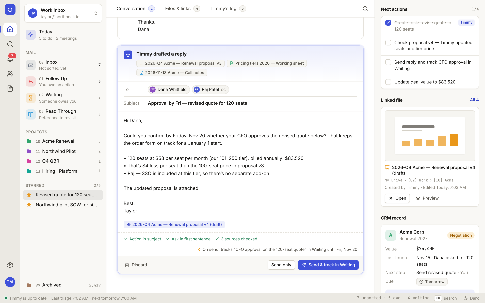

# Timmy

Frontend for **Timmy**: an AI layer over Gmail plus its own workspace (Drive, Docs, Sheets, Slides, Calendar, Tasks, a personal CRM and an AI library), so people get a Google Workspace-style suite without paying Google for it. Timmy sorts your inbox, drafts replies from your files, and keeps track of what you owe and what you're waiting on.


This is the frontend only: everything runs in the browser on sample data, and your changes are saved in the browser (Settings › Reset demo data starts over). Gmail is the only service the product will connect to (the voice option downloads its speech model from Hugging Face once). The clock is fixed at Monday, Nov 16, 2026, 8:12 AM, so due dates and "late" labels stay consistent.

Live preview: https://web-production-c4bbfc9c.up.railway.app (Railway, redeploys on every push to this branch).

```bash
npm install
npm run dev      # http://localhost:5173
npm run build    # type-check + production build
```

## Layout

The shell follows the wireframe: **left rail · sidebar · tabs + main content · right sidebar · bottom bar**.

| Area | What it holds |
| --- | --- |
| Left rail | Today & mail, Approvals, Search (⌘K), Tasks, Calendar, Docs, Projects, People, Drive, AI library, Timmy's activity, Settings |
| Sidebar | Changes with the section. For mail it shows numbered labels, project folders, Starred (max 5) and `[99] Archived` |
| Tabs | Views inside the current page (e.g. Daily brief / Triage / Drafts) |
| Main content | The page itself |
| Right sidebar | Context for whatever is open (next actions, linked file, CRM record, today's calendar) on top, and **Ask Timmy**, a chat docked at the bottom |
| Bottom bar | Agent status, last/next triage run, counts, theme toggle |

Below 1280px the right sidebar becomes a drawer. Below 900px the sidebar does too.

## How mail is organized

- **[00] Inbox** — not sorted yet. Timmy suggests a label for each email and you confirm in **Triage**, oldest first.
- **[01] Follow Up** — you owe an action. Two-minute replies are drafted and marked *Quick*; bigger work gets a task and a focus block.
- **[02] Waiting** — someone owes you. A thread stays here until the item arrives. A promise to send it doesn't count.
- **[03] Read Through** — reports and how-to emails you'll consult again.
- **[10]–[13] Projects** — mail filed where you'll use it.
- **[99] Archived** — done, still searchable.

The main flow: Dana asks for a revised quote → Timmy finds proposal v3, makes a v4, creates a task, blocks focus time and drafts a reply → **Send & track in Waiting** moves the thread to Waiting with the approval deadline → Timmy suggests the CRM update.



Files follow a numbered folder structure (`[02] Work › [10] Acme`, at most 5 levels deep) and dated names (`2026-11-13 Acme — Call notes`, `2026-Q4 QBR — Briefing slides`).

## The morning run, urgency and approvals

- **Morning run:** Timmy sorts new mail, ranks it, drafts replies and lines up decisions at the time you pick (default 8:00 AM on weekdays). Change the time from the daily brief or Settings › Schedule; the status bar shows the next run.
- **Urgency:** every open thread is ranked Urgent, Soon or Can wait, with the reasons shown ("Due today at 5:00 PM · Marcus is a priority contact · Says “today”"). The brief leads with only the urgent ones, or everything open if you prefer. Each signal is a rule in Settings › Urgency, and you can mark any thread urgent or able to wait yourself.
- **Approvals:** one queue for everything that needs your OK: emails to send, decisions on price or hiring, CRM updates and calendar invites. Each decision shows the numbers and what Timmy will do for each choice. Nothing is sent without approval, every choice is logged under Decided, and Undo is on the notice that follows.

## Ask Timmy (chat)

The chat at the bottom of the right sidebar answers from what's in the app and knows what's open: "What's urgent?", "What needs my approval?", "Summarize this thread", "Draft a reply", "Brief me on the pipeline", "Find focus time today", "Move my brief to 7:30", "Remind me to … tomorrow", "Find …", and research or competitor questions (it says plainly that outside sources aren't connected yet and offers to start a research doc). Anything that changes data is proposed with a button; nothing happens until you confirm. The answers come from a local engine over the sample data; a real model replaces `reply()` in `src/state/assistant.ts`.

## Voice

Talk instead of typing, as in [OpenWhispr](https://github.com/OpenWhispr/openwhispr) (MIT), but in the browser:

- **Mic buttons** in a reply, a new email and Ask Timmy; **push-to-talk** anywhere by holding Ctrl+Shift+Space (changeable). With a text field focused the words land at the cursor; with nothing focused they go to Ask Timmy.
- **Engines** (Settings › Voice): *Private* runs Whisper in your browser (downloaded once from Hugging Face, then cached; audio never leaves the device) and *Fast* uses the browser's own speech recognition (Chrome and Edge send audio to their speech service).
- **Dictionary:** names and companies from your contacts are corrected after transcription ("dana whitefield at north peak" → "Dana Whitfield at Northpeak").

The microphone needs HTTPS (Railway serves it).

## Files: WordCraft, GridCraft, DeckCraft and PdfCraft

Documents, spreadsheets, presentations and PDFs open inside Timmy in the open-source [Craft apps](https://getartcraft.com/apps) by ArtCraft (MIT or Apache-2.0): [WordCraft](https://github.com/storytold/wordcraft) (.docx, .odt, .rtf, .md…), [GridCraft](https://github.com/storytold/gridcraft) (.xlsx, .xls, .ods, .csv), [DeckCraft](https://github.com/storytold/deckcraft) (.pptx) and [PdfCraft](https://github.com/storytold/pdfcraft) (.pdf). They're Rust apps compiled to WebAssembly and served by this site from `public/craft/<app>/`, so everything stays a web app.

- **Click any file** in Drive, a project or search to open it. PDFs and uploaded office files open straight in their app. Timmy's own docs, sheets and decks keep the Timmy editor (which Timmy reads for drafts and linked tables) with a switch to open a .docx/.xlsx/.pptx copy in the Craft app, and a Download button.
- **Upload** from Drive or a project's Files tab. The bytes stay in the browser (IndexedDB).
- **Save** inside the app (File › Save) stores the file back in Drive; Save As or an export to another format adds a copy next to it. Unsaved changes are shown and guarded, and a file one app hands to another (for example PDF → Word) opens in the right app.

How it's wired: `src/areas/viewers/CraftViewer.tsx` frames `/craft/<app>/index.html?host=parent` and speaks the apps' host messages ([craft-web-host](https://github.com/storytold/craft-libs/tree/main/crates/web-host): `ready` → `open {name, bytes}`; `save`, `dirty`, `failed`, `handoff`). `src/lib/office.ts` exports Timmy docs, sheets (formulas become cell formulas) and decks. The demo files are in `public/samples` (`npm run samples` regenerates them).

To rebuild the apps (Rust with the `wasm32-unknown-unknown` target and `wasm-bindgen-cli` 0.2.129; about 30 minutes for all four):

```bash
npm run craft
```

Each app's `.wasm` ships gzipped (10–22 MB) and is decompressed in the browser. The apps need WebGPU or WebGL2, which every current browser has.

## Workflows it supports

Each follows Jeff Su's published system.

| Workflow | Where | What you can do |
| --- | --- | --- |
| 1. Drive folders and filing | Drive | Numbered folders (5 deep, 99 = archive), "Where will you use this?" filing with dated names, leave / shortcut / copy for shared files, star 5 at most, description keywords |
| 2. Gmail | Today & mail | Triage into Follow Up / Waiting / Read Through, 2-minute replies, compose with Track in Waiting, Ask Timmy to draft, send a recap |
| 3. Tasks, quick notes, Calendar | Tasks, Calendar | Quick capture (⌘J), thoughts vs. notes, tasks from emails, weekly review queue, block time, daily highlight |
| 4. Docs and meetings | Docs | Create and name in one step, templates, running 1:1 table, team tracker, linked files, recap email |
| 5. Sheets and Slides | Docs | Named-column formulas, linked tables that refresh in docs, decks from layouts, copy slides to [04] Quick Share |
| 6. Project dashboard | Projects | Project home with tasks, notes, mail, files and AI; New task / New note link themselves; active and archived views |
| 7. Personal CRM | People | Start with 10–20 people, one or two priority contacts, reviews by cadence, contact history |
| 8. Browser and AI | AI library, search | Prompts captured then filed by use case, routines, rules learned from your edits, project sources |
| One workday | Mail → Tasks → Calendar → Sheets → Docs → Projects | Email to Follow Up, task, time block, update the tracker (linked doc refreshes), reply asking for approval, Waiting, approval arrives (demo button), decision recorded in the project's running notes |

## Try it

- **Today:** review the draft, accept triage suggestions, update the CRM from a suggestion
- **Thread:** the whole conversation is shown with the reply box open below it. `F` / `W` / `R` / `E` move the thread, `S` stars it, `A` replies, `D` asks Timmy to draft, `Esc` goes back. Edit the draft, then **Send & track**. On a Waiting thread, **Demo: … replies** simulates the answer. Every move can be undone from the toast.
- **Anywhere:** `C` composes, `⌘J` quick-captures a task or note, hold Ctrl+Shift+Space to talk
- **Files:** open the Acme project › Files and click the order form (.docx), the MSA redlines (.pdf) or the quote tracker (switch to GridCraft); the Northwind budget (.xlsx) and the Hiring interview loop (.pptx) are in their projects
- **Search:** `⌘K` or `/`. Operators: `from:dana`, `is:waiting`, `project:acme`, `has:draft`, `has:attachment`
- **Rules:** toggle rules or add one in plain language
- **Appearance:** pick Light, Dark or Match system, and one of three dark palettes (Midnight, Graphite, Espresso) from the bottom bar or Settings › Appearance. The choice is saved in the browser.

## Design checks

The [Impeccable](https://impeccable.style) design skill is installed in `.claude/skills/impeccable`. Run its detector against the dev server or the source:

```bash
npx impeccable detect http://localhost:5173
npx impeccable detect src/
```

Known, intentional findings: em-dashes in file names (they're part of the naming convention) and the left-rail tooltip overlapping the sidebar while hovered.

## Code

```
src/
  data/       types.ts + mock.ts (mail), ws-types.ts + ws-mock.ts (workspace seed)
  state/      store.tsx (reducer, undo, saved in the browser), ws.ts (workspace helpers), theme.tsx,
              urgency.ts (ranking), approvals.ts (the queue), schedule.ts (morning run), assistant.ts (Ask Timmy)
  lib/        office.ts (.docx/.xlsx/.pptx export), blobs.ts (file bytes in IndexedDB), dictation.ts + whisper.worker.ts (voice)
public/craft  the four Craft apps' web builds (scripts/build-craft.sh, scripts/package-craft.py)
  components/ shell (LeftRail, Sidebar, Frame, RightPanel, BottomBar), Compose, SearchPalette, kit.tsx
  views/      mail screens: TodayView, MailboxView, ThreadView, OtherViews, AppearanceView
  areas/      approvals, tasks, calendar, docs (docs, sheets, slides), projects, people, files (Drive), library,
              viewers (the Craft apps: CraftViewer, upload)
  styles/     tokens.css (light + Midnight/Graphite/Espresso), layout, ui, views, kit, one file per area
```

Workspace data changes through one action: `dispatch(ws([put(...), patch(...), remove(...)], { toast, undo }))`. To connect Gmail later, replace the mail half of `src/data/mock.ts` with API calls; the workspace stays local or moves to Timmy's own storage.
