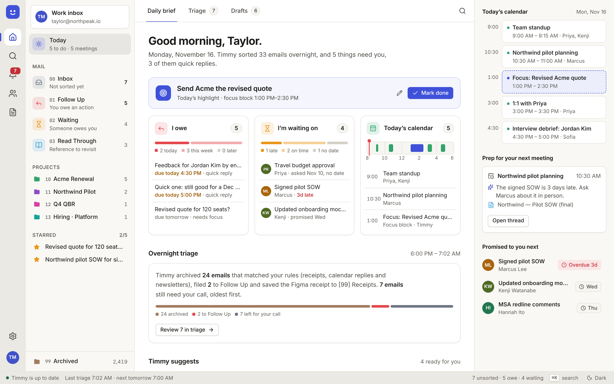

# Timmy

Frontend for **Timmy**, an email agent that sorts your inbox, drafts replies from your files, and keeps track of what you owe and what you're waiting on.



This is a clickable prototype running on mock data. The clock is fixed at Monday, Nov 16, 2026, 8:12 AM, so due dates and "late" labels stay consistent.

```bash
npm install
npm run dev      # http://localhost:5173
npm run build    # type-check + production build
```

## Layout

The shell follows the wireframe: **left rail · sidebar · tabs + main content · right sidebar · bottom bar**.

| Area | What it holds |
| --- | --- |
| Left rail | Sections: Today & mail, Search (⌘K), Timmy's activity, People, Files, Rules |
| Sidebar | Changes with the section. For mail it shows numbered labels, project folders, Starred (max 5) and `[99] Archived` |
| Tabs | Views inside the current page (e.g. Daily brief / Triage / Drafts) |
| Main content | The page itself |
| Right sidebar | Context for whatever is open: next actions, linked file, CRM record, people, today's calendar |
| Bottom bar | Agent status, last/next triage run, counts, theme toggle |

Below 1280px the right sidebar becomes a drawer. Below 900px the sidebar does too.

## How mail is organized

- **[00] Inbox** — not sorted yet. Timmy suggests a label for each email and you confirm in **Triage**, oldest first.
- **[01] Follow Up** — you owe an action. Two-minute replies are drafted and marked *Quick*; bigger work gets a task and a focus block.
- **[02] Waiting** — someone owes you. A thread stays here until the item arrives. A promise to send it doesn't count.
- **[03] Read Through** — reports and how-to emails you'll consult again.
- **[10]–[13] Projects** — mail filed where you'll use it.
- **[99] Archived** — done, still searchable.

The main flow: Dana asks for a revised quote → Timmy finds proposal v3, makes a v4, creates a task, blocks focus time and drafts a reply → **Send & track in Waiting** moves the thread to Waiting with the approval deadline → Timmy suggests the CRM update.


Files follow a numbered folder structure (`[02] Work › [10] Acme`, at most 5 levels deep) and dated names (`2026-11-13 Acme — Call notes`, `2026-Q4 QBR — Briefing slides`).

## Try it

- **Today:** review the draft, accept triage suggestions, update the CRM from a suggestion
- **Thread:** `F` / `W` / `R` / `E` move the thread, `S` stars it, `Esc` goes back. Edit the draft, then **Send & track**. Every move can be undone from the toast.
- **Search:** `⌘K` or `/`. Operators: `from:dana`, `is:waiting`, `project:acme`, `has:draft`, `has:attachment`
- **Rules:** toggle rules or add one in plain language
- **Appearance:** pick Light, Dark or Match system, and one of three dark palettes (Midnight, Graphite, Espresso) from the bottom bar or Settings › Appearance. The choice is saved in the browser.

## Design checks

The [Impeccable](https://impeccable.style) design skill is installed in `.claude/skills/impeccable`. Run its detector against the dev server or the source:

```bash
npx impeccable detect http://localhost:5173
npx impeccable detect src/
```

Known, intentional findings: em-dashes in file names (they're part of the naming convention) and the left-rail tooltip overlapping the sidebar while hovered.

## Code

```
src/
  data/       types.ts, mock.ts (people, threads, docs, deals, calendar, rules)
  state/      store.tsx — reducer for moves, triage, sending drafts, undo
  components/ shell (LeftRail, Sidebar, Frame, RightPanel, BottomBar), SearchPalette, shared bits
  views/      TodayView, MailboxView, ThreadView, OtherViews (activity, people, files, rules)
  state/      theme.tsx — light/dark mode and the dark palette, saved per browser
  styles/     tokens.css (light + Midnight/Graphite/Espresso), layout.css, ui.css, views.css
```

To connect a backend, replace `src/data/mock.ts` with API calls and turn the reducer actions in `src/state/store.tsx` into requests.
